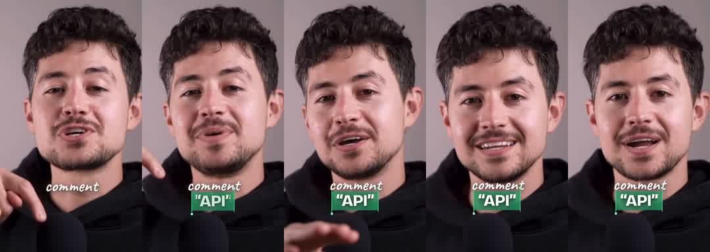

# v09_s12 · 14 Título - cierre - CTA · 27.4–29.9s (calidad 5)

- **Guion:** comment API down below, and I'll send it to you directly.
- **Qué se ve:** 'comment' en script blanca y '"API"' blanco en caja verde con asas (esquinas cuadradas), fijo hasta el final. (observado 27.5–29.5)
- **Diseño:** 'comment' y≈74 %; caja verde ~#2E7A5A aprox, y 76.5–83.6 %, ~22 % ancho.
- **Efectos:** —
- **Animación:** 'comment' gris→blanco 27.5; caja verde aparece vacía 27.75 y 'API' dentro 28.0.
- **Por qué aquí:** Palabra a comentar en el color del lienzo.
