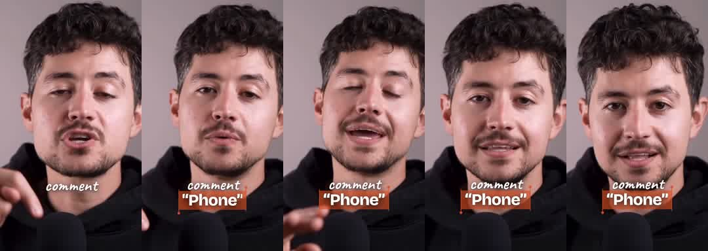

# v10_s13 · 14 Título - cierre - CTA · 26.4–28.9s (calidad 5)

- **Guion:** comment phone down below and I'll send you the links directly.
- **Qué se ve:** 'comment' script blanca y '"Phone"' blanco en caja naranja #803010 con asas, fijo hasta el final. (observado 26.5–28.5)
- **Diseño:** 'comment' y≈74 %; caja naranja y 77–83 %, ~35 % ancho.
- **Efectos:** —
- **Animación:** 'comment' 26.5; caja naranja vacía 26.75; 'Phone' 27.0.
- **Por qué aquí:** Palabra a comentar en el color del lienzo.
