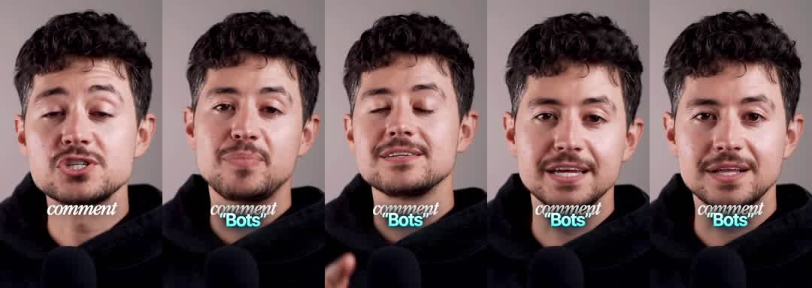

# v11_s17 · 14 Título - cierre - CTA · 38.8–40.8s (calidad 4)

- **Guion:** comment bots, and we'll send you the link directly.
- **Qué se ve:** [obs 38.75–40.5] Mismo plano; 'comment' en serif itálica blanca y debajo '"Bots"' en sans bold con degradado cian brillante.
- **Diseño:** [medido 40.0] 'comment' serif itálica blanca y 71–74 %; '"Bots"' y 74.5–78.6 %, degradado #47A9B6→#BBFDFE con glow; solapadas.
- **Efectos:** [obs] glow cian alrededor de 'Bots'.
- **Animación:** [obs 38.75] 'comment' aparece; [obs 39.25] '"Bots"' pop debajo (≈0.1 s); se mantiene hasta el final.
- **Por qué aquí:** [inf] CTA de palabra clave para automatizar DMs.
