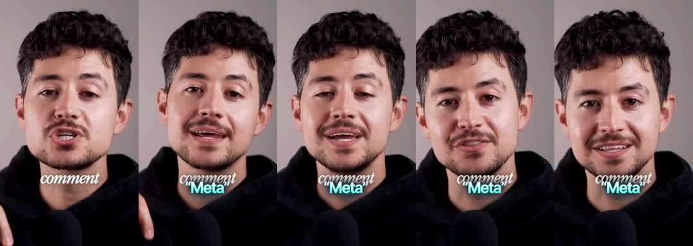

# v12_s15 · 14 Título - cierre - CTA · 32.3–35.0s (calidad 4)

- **Guion:** comment Meta down below and I'll send you all the link directly.
- **Qué se ve:** [obs 32.25–34.75] 'comment' serif itálica blanca y debajo '"Meta"' con degradado cian y glow.
- **Diseño:** [medido 33.5] bloque y≈71–75 %; mismo tratamiento que v11 (degradado cian→blanco con glow).
- **Efectos:** glow cian
- **Animación:** [obs] 'comment' 32.25; '"Meta"' pop 32.75.
- **Por qué aquí:** [inf] CTA con palabra clave = nombre de la marca del hook.
