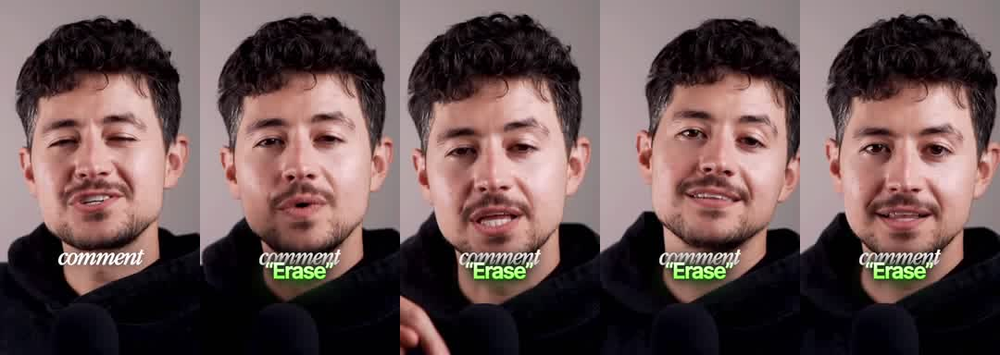

# v13_s18 · 14 Título - cierre - CTA · 44.9–47.8s (calidad 4)

- **Guion:** comment your race down below and I'll send you the link directly.
- **Qué se ve:** [obs 44.75–46.5] 'comment' serif itálica blanca + '"Erase"' con degradado VERDE y glow.
- **Diseño:** [medido 46.0] '"Erase"' y 74.7–78.6 %, degradado #73B843→#C4FEA0.
- **Efectos:** glow verde
- **Animación:** [obs] 'comment' 44.75, palabra pop ≈45.25.
- **Por qué aquí:** [inf] Palabra clave del CTA = verbo del título ('Erase'); el color cambia por video.
