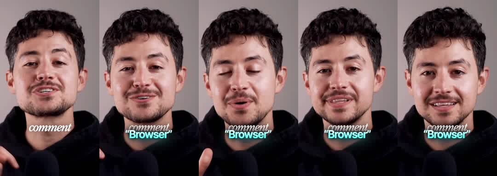

# v14_s18 · 14 Título - cierre - CTA · 42.9–45.7s (calidad 4)

- **Guion:** comment browser down below and it'll DM you the link directly.
- **Qué se ve:** [obs 42.75–44.75] 'comment' serif itálica blanca + '"Browser"' con degradado cian y glow.
- **Diseño:** Bloque y≈71–79 %; degradado cian como v11.
- **Efectos:** glow cian
- **Animación:** [obs] 'comment' 42.75; palabra pop 43.25.
- **Por qué aquí:** [inf] Palabra clave = objeto del título.
