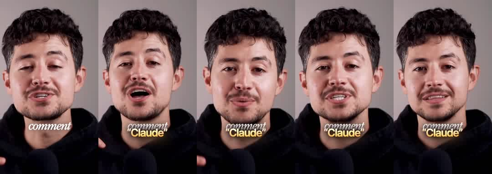

# v15_s20 · 14 Título - cierre - CTA · 48.9–51.6s (calidad 4)

- **Guion:** comment Clawed down below and I'll send them to you directly.
- **Qué se ve:** [obs 49.0–51.25] 'comment' serif itálica blanca + '"Claude"' con degradado dorado y glow.
- **Diseño:** Bloque y≈71–79 %; degradado ámbar→crema (aprox., ver s02).
- **Efectos:** glow cálido
- **Animación:** [obs] 'comment' 49.0; palabra pop 49.25.
- **Por qué aquí:** [inf] Palabra clave = marca del título; color dorado en este video.
