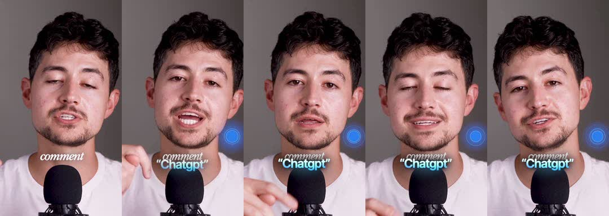

# v16_s19 · 14 Título - cierre - CTA · 29.7–32.0s (calidad 4)

- **Guion:** just comment ChatGBT down below, and I'll send it to you directly.
- **Qué se ve:** Nick full; 'comment' serif itálica blanca pequeña encima y '“Chatgpt”' sans bold con degradado blanco→azul debajo; orbe azul brillante (botón tipo grabación) a la derecha a media altura.
- **Diseño:** 'comment' serif itálica ~3 % alto a y≈70 %; '“Chatgpt”' sans extra-bold ~4.5 % alto a y≈73 %, degradado blanco→cian (#A8F8F8→#68D8F8, muestreado 30.5) con glow azul; orbe azul #2A6BFF Ø≈5 % ancho a x≈93 %, y≈62 % con halo.
- **Efectos:** Glow azul en palabra y orbe.
- **Animación:** [observed 29.8] 'comment' aparece; [observed 29.93] orbe fade-in; [observed 30.2–30.27] 'Chatgpt' blur-in. Se mantiene hasta el final.
- **Por qué aquí:** [inferred] CTA de palabra clave (automatización de DMs) con el término del video.
