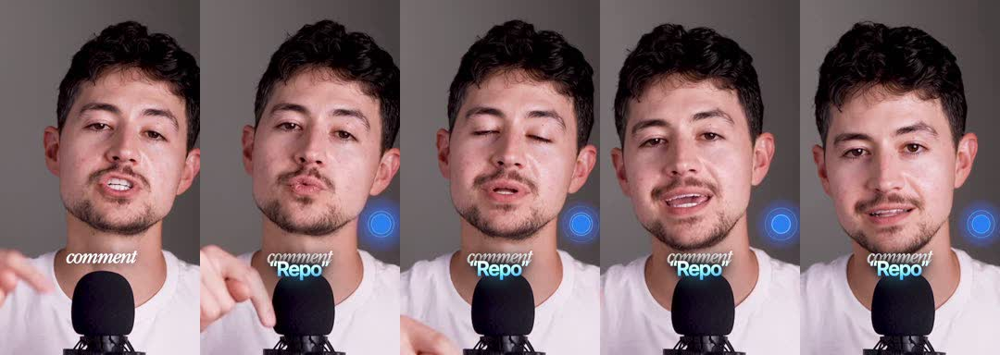

# v17_s26 · 14 Título - cierre - CTA · 46.0–48.4s (calidad 4)

- **Guion:** just comment a repo down below and I'll send you the links.
- **Qué se ve:** 'comment' serif itálica + '“Repo”' degradado blanco→azul; orbe azul con halo a la derecha.
- **Diseño:** Como v16: 'comment' y≈70 %, palabra y≈73 %, orbe x≈93 % y≈60 %.
- **Efectos:** Glow.
- **Animación:** [observed 46.13] 'comment' + orbe fade-in; [observed ~46.47] '“Repo”' blur-in.
- **Por qué aquí:** [inferred] CTA de palabra clave.
