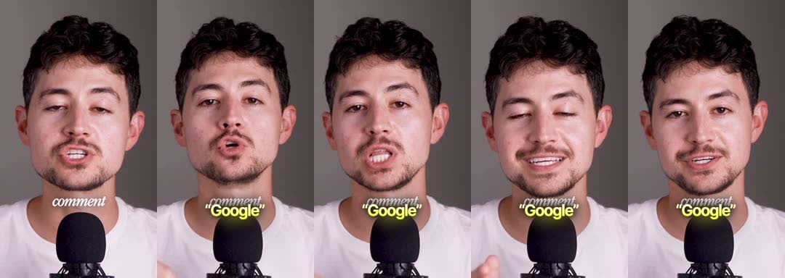

# v19_s20 · 14 Título - cierre - CTA · 40.0–42.3s (calidad 4)

- **Guion:** just comment Google down below and I'll DM you the link directly.
- **Qué se ve:** 'comment' serif itálica blanca y '“Google”' sans bold con degradado blanco→AMARILLO y glow amarillo; SIN orbe azul.
- **Diseño:** 'comment' y≈70 %, '“Google”' y≈73.5 %; degradado blanco→amarillo (#F8F8B8→#F8F858, muestreado 41.0)
- **Efectos:** Glow amarillo.
- **Animación:** [observed 39.87] 'comment'; [observed 40.13–40.47] 'Google' blur-in (≈10 fr).
- **Por qué aquí:** [inferred] CTA palabra clave; color distinto del habitual (amarillo).
