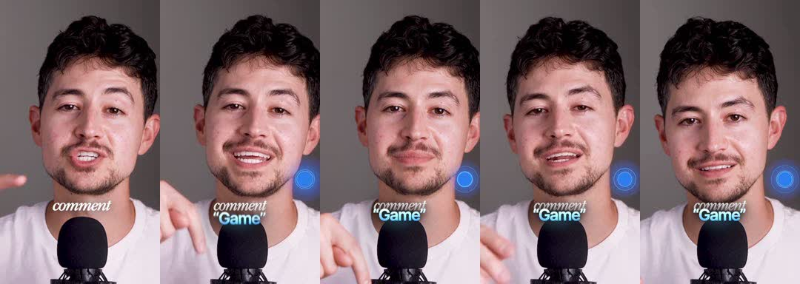

# v20_s17 · 14 Título - cierre - CTA · 35.0–37.0s (calidad 4)

- **Guion:** just comment game down below and I'll send you the links.
- **Qué se ve:** 'comment' serif itálica + '“Game”' degradado blanco→cian; orbe azul a la derecha.
- **Diseño:** 'comment' y≈70 %, '“Game”' y≈73 %; degradado #B8F8F8→#98E8F8 (muestreado 35.5); orbe x≈93 % y≈62 %.
- **Efectos:** Glow.
- **Animación:** [observed 35.07] 'comment'; [observed 35.13] orbe; [observed ~35.53] 'Game' blur-in.
- **Por qué aquí:** [inferred] CTA palabra clave.
