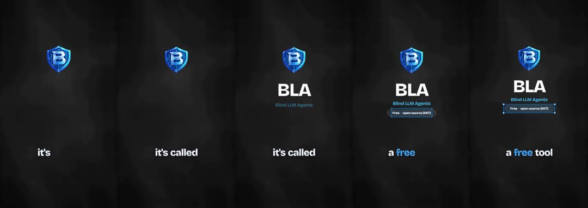

# v01_s03 · card_graphic · 4.6–6.1s (calidad 4)

- **Guion:** It's called BLA, a free tool
- **Qué se ve:** [obs] Lienzo solo (sin título, sin ventana, sin cara). Escudo 'B' azul arriba, 'BLA' grande blanco, debajo 'Blind LLM Agents' azul pequeño y píldora 'Free · open source (MIT)' dentro de un marco de selección. Caption 'a free tool' con 'free' azul.
- **Diseño:** [obs] Escudo ~8 % ancho centrado y≈30 %; 'BLA' sans black blanca ~5.5 % alto, y 40–46 %; subtítulo azul sans ~1 %; píldora gris oscura con texto blanco pequeño. Caption sans bold y 71.7–74.9 % (centro ≈73 %).
- **Efectos:** [obs] Cuadrícula de fondo visible; glow suave azul alrededor del escudo [inf].
- **Animación:** [obs] Corte seco a lienzo vacío (4.40–4.45, 1–2 frames), escudo entra con fade+leve escala (4.47→4.6), 'BLA' aparece en gris y pasa a blanco (5.0→5.2) en 'BLA', subtítulo y píldora aparecen con su marco de selección (5.4–5.7) en 'free'.
- **Por qué aquí:** [inf] Anuncio del nombre: se limpia todo para que el nombre tenga la pantalla entera (anunciar = pantalla limpia).
