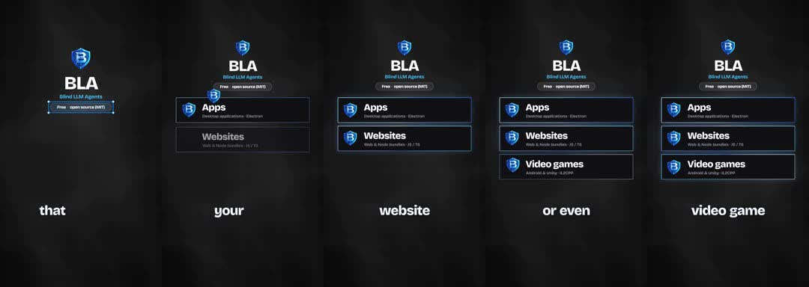

# v01_s04 · card_graphic · 6.1–8.5s (calidad 4)

- **Guion:** that protects your app, website, or even video game.
- **Qué se ve:** [obs] El bloque logo+BLA sube y se encoge; debajo aparecen 3 tarjetas apiladas 'Apps', 'Websites', 'Video games' con icono del escudo y subtexto gris.
- **Diseño:** [obs] Tarjetas rectangulares ~83 % ancho, fondo negro con borde azul fino y asas de selección al aparecer; título blanco sans semibold, subtexto gris pequeño. Caption y≈73 %.
- **Efectos:** [obs] Cuadrícula; tarjetas sin sombra visible.
- **Animación:** [obs] 6.07–6.3 el bloque del logo se desliza hacia arriba y reduce (~1.0→0.6); cada tarjeta entra en gris translúcido y se 'activa' (blanca con marco azul) en su palabra: 'Apps' ~6.5 ('your app' 6.7), 'Websites' ~6.9 (7.1), 'Video games' ~7.6 (7.64). Escalonado ~0.5 s.
- **Por qué aquí:** [inf] Lista dicha = lista mostrada: cada tarjeta se enciende con la palabra para que el ojo siga la enumeración.
