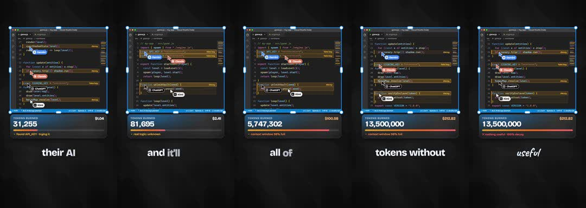

# v01_s09 · card_graphic · 18.1–21.6s (calidad 5)

- **Guion:** their AI gets confused and it'll burn through all of their tokens without getting anything useful.
- **Qué se ve:** [obs] El contador TOKENS BURNED se dispara: 16,435 → 42,177 → 342,564 → 2,425,674 → 13,500,000 y el coste sube a $210.22; la barra se llena roja y aparece texto rojo '0 nothing useful · 100% decoy'.
- **Diseño:** [obs] Número sans bold blanco grande (~3 % alto) en la tarjeta; texto de estado rojo pequeño. 'useful' en serif itálica blanca.
- **Efectos:** [obs] Barra naranja→roja.
- **Animación:** [obs] Contador rueda continuo 18.0–20.5 (aceleración exponencial), se congela en 13,500,000 en 'tokens without' (~20.4). [inf] subida acompañada de SFX tick (no verificable).
- **Por qué aquí:** [inf] Dato/consecuencia: la cifra que crece hace sentir el 'quemar tokens'; se congela justo al decir 'nada útil'.
