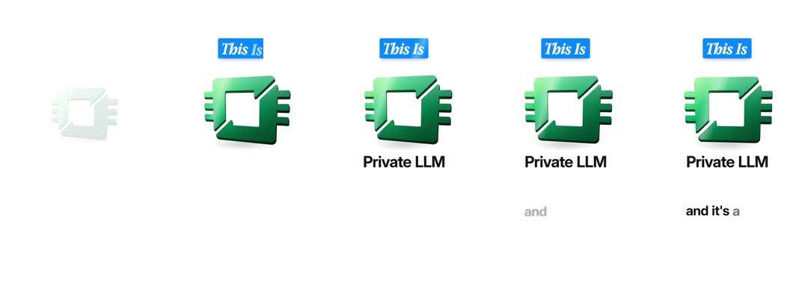

# v02_s04 · card_graphic · 4.1–5.8s (calidad 4)

- **Guion:** This is PrivateLM and it's a fully
- **Qué se ve:** [obs] Lienzo blanco puro: 'This Is' en caja azul arriba, logo 3D de chip verde grande al centro, 'Private LLM' sans bold negra debajo; caption negra.
- **Diseño:** [obs] 'This Is' serif itálica bold blanca en caja azul #0D88FA (y 13.8–19.8 %); logo ~40 % ancho centrado y≈25–40 %; 'Private LLM' sans bold negra ~3 % alto y≈42–45 %; caption sans bold negra y≈52 %.
- **Efectos:** [obs] Lienzo #FFFFFF sin cuadrícula; logo con volumen/sombra propia.
- **Animación:** [obs] Corte a blanco en ~4.16; logo entra con fade + escala (blanco translúcido→verde, 4.2–4.3); caja de 'This Is' se abre desde una línea (4.3–4.36) y el texto aparece 4.43; 'Private' gris→ 'Private LLM' negro en 4.5–4.75.
- **Por qué aquí:** [inf] Presentación del producto: pantalla limpia y color de lienzo distinto para marcar 'este es el nombre'.
