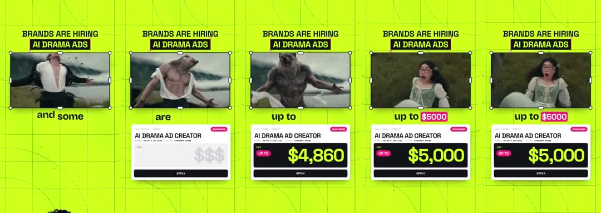

# v07_s02 · card_graphic · 2.3–4.6s (calidad 5)

- **Guion:** and some listings are paying up to $5,000.
- **Qué se ve:** Título y ventana siguen (clip de hombre que se transforma en hombre lobo 2.25–3.75, luego mujer con vestido); la cara desaparece y entra una tarjeta de oferta 'AI DRAMA AD CREATOR' con cifra que rueda $$$ → $1,980 → $4,440 → $5,000 y botón APPLY. (observado 2.5–4.25)
- **Diseño:** Tarjeta blanca x ~10–90 % × y ~56–83 %, cifra sans black lima sobre caja negra grande, chip 'UP TO' magenta. Caption 'up to $5000' con '$5000' en caja magenta, y≈54 %.
- **Efectos:** Sombra suave bajo la tarjeta.
- **Animación:** Tarjeta entra deslizándose desde la izquierda (2.5, borde visible a la izq.) con contador que rueda 0.75 s; la cara se va por corte. (observado 2.5–3.5)
- **Por qué aquí:** Dato de dinero hecho tangible con un anuncio de empleo real.
