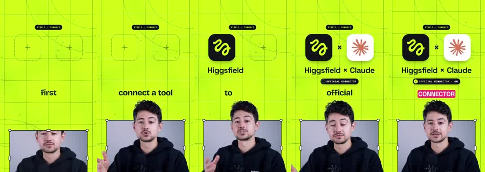

# v07_s04 · card_graphic · 6.8–9.6s (calidad 5)

- **Guion:** First, connect a tool like Higgsfield to Claude with its official connector,
- **Qué se ve:** Chip negro 'STEP 1 · CONNECT' arriba y dos huecos punteados con '+'; el icono de Higgsfield (negro, logo lima) cae en el 1º (7.6), '× Claude' (logo naranja) en el 2º (8.2) y chip 'OFFICIAL CONNECTOR · ON' (8.75). Él sube en recuadro abajo. (observado 6.75–9.25)
- **Diseño:** Iconos app ~18 % ancho a y≈13–20 %; rótulo 'Higgsfield × Claude' sans negra; caption y≈54 %: 'HIGGSFIELD', 'CONNECTOR' en caja magenta.
- **Efectos:** Lienzo lima.
- **Animación:** Recuadro de cara entra deslizando desde abajo en ~2 fr con tinte cian momentáneo (6.85–7.0, observado); iconos pop (escala desde ~80 %, ~0.15 s).
- **Por qué aquí:** Paso 1 = diagrama de conexión literal (A × B).
