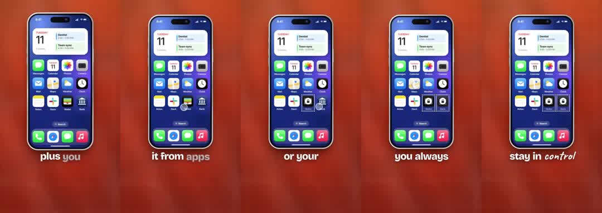

# v10_s11 · card_graphic · 21.3–25.2s (calidad 4)

- **Guion:** Plus you can block it from apps like Wallet or your banking apps, you always stay in control.
- **Qué se ve:** Mockup de iPhone (pantalla de inicio) centrado sobre el naranja; un círculo/cursor marca Wallet (22.5–23.0) y luego Bank (23.25–23.75) con caja de selección. (observado)
- **Diseño:** Móvil x 24–76 % × y 7–70 %; caption y≈73 %: 'block', 'control' en script itálica.
- **Efectos:** Sombra del móvil.
- **Animación:** Móvil entra con escala ~110→100 % (zoom-out de asentamiento, 21.2–21.4); marcadores pop.
- **Por qué aquí:** Seguridad = control visible sobre apps sensibles.
