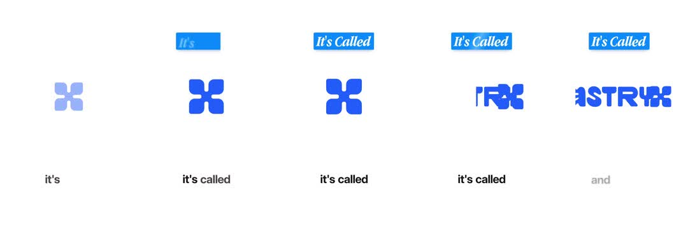

# v12_s04 · card_graphic · 8.6–9.7s (calidad 5)

- **Guion:** It's called Asterix,
- **Qué se ve:** [obs 8.5–9.5] Lienzo blanco puro: caja azul 'It's Called' arriba y el icono de Astryx (cruz azul) en el centro que se transforma en el logotipo 'ASTRYX'.
- **Diseño:** Caja azul ~#1681ED con serif itálica blanca y≈13–20 %; icono/logotipo azul ~#1F4FE0 centrado y≈35 %; subtítulo gris 'it's called' y≈52 %.
- **Efectos:** [obs] blanco plano sin grano.
- **Animación:** [obs 8.5] frame blanco vacío; 8.55 icono aparece con fade; 8.75 caja azul crece desde un rectángulo; 9.3–9.6 el icono se desliza a la derecha y el logotipo se revela con máscara de izquierda a derecha (≈0.3 s).
- **Por qué aquí:** [inf] Name card: el blanco separa la presentación del producto.
