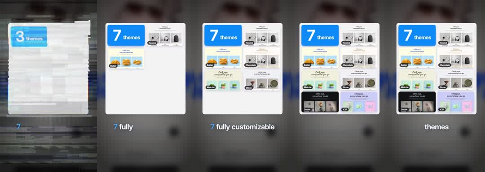

# v12_s10 · card_graphic · 19.3–21.4s (calidad 5)

- **Guion:** seven fully customizable themes,
- **Qué se ve:** [obs 19.25–21.25] Tras un glitch, cuadrícula de tarjetas de temas (Neutral, Butter, Chocolate, Matcha…) con tile azul '7 themes'; las tarjetas se van rellenando.
- **Diseño:** Tile azul #1681ED aprox. con '7' sans bold blanca grande + 'themes'; mosaico 3×4 dentro de la ventana blanca; '7' azul en subtítulo.
- **Efectos:** [obs 19.15–19.3] glitch: cortes horizontales, desplazamiento y ruido (~0.15 s).
- **Animación:** [obs] tarjetas aparecen escalonadas de arriba a abajo (19.75–20.75), una fila cada ~0.25 s.
- **Por qué aquí:** [inf] Dato (7 temas) con prueba visual de variedad.
