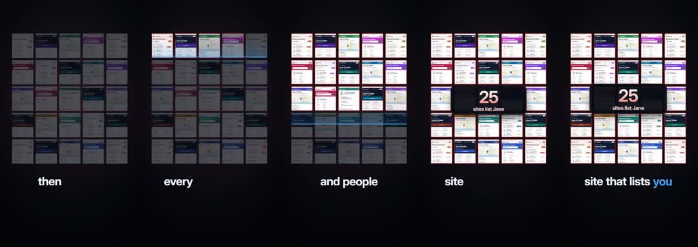

# v13_s09 · card_graphic · 19.0–22.9s (calidad 5)

- **Guion:** Then it'll find every data broker and people search site that lists you.
- **Qué se ve:** [obs 19.0–22.5] Mosaico de ~30 webs atenuadas en gris que se 'encienden' en color al pasar una línea de escaneo horizontal azul de arriba abajo; en 21.75 aparece una tarjeta glass '25 sites list Jane'.
- **Diseño:** Tarjeta oscura translúcida centrada y≈45 %, '25' sans bold blanca ~6 % alto.
- **Efectos:** [obs] línea de escaneo luminosa, desaturado→color.
- **Animación:** [obs] escaneo 19.75–21.5 (≈1.7 s); tarjeta pop 21.75.
- **Por qué aquí:** [inf] Visualiza el rastreo automático y cuantifica el resultado.
