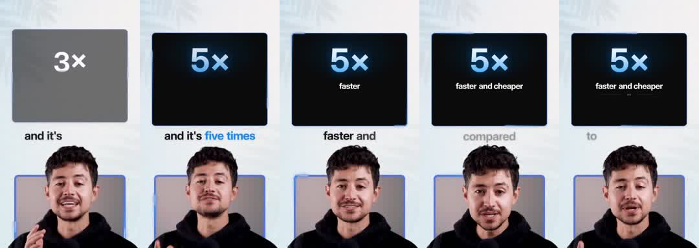

# v14_s03 · card_graphic · 7.0–9.3s (calidad 5)

- **Guion:** and it's five times faster and cheaper compared to
- **Qué se ve:** [obs 7.0–9.0] Vuelve lienzo claro + cara; en el hueco de la ventana una tarjeta negra con '5×' azul brillante que cuenta 0×→2×→3×→4×→5×, debajo 'faster' y 'and cheaper'.
- **Diseño:** Tarjeta negra #0B0B0F redondeada ~24 px, y 13.3–34 %, '5×' sans bold degradado azul claro con glow ~8 % alto; subtítulo negro y≈55 %, 'five times' azul.
- **Efectos:** [obs] glow azul en la cifra; la tarjeta pasa de gris a negro mientras cuenta.
- **Animación:** [obs 6.95–7.25] contador rodante (≈0.3 s); 'faster' 7.75 y 'and cheaper' 8.25 con write-on.
- **Por qué aquí:** [inf] Dato comparativo → cifra gigante.
