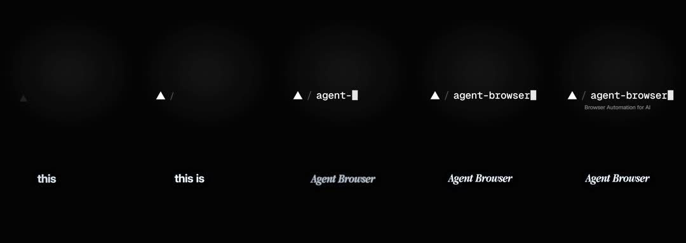

# v14_s06 · card_graphic · 13.1–14.6s (calidad 5)

- **Guion:** This is called Agent Browser,
- **Qué se ve:** [obs 13.0–14.5] Pantalla negra con resplandor radial; aparece el triángulo de Vercel y se teclea 'agent-browser' con cursor de bloque; debajo 'Browser Automation for AI'; subtítulo 'Agent Browser' en serif itálica.
- **Diseño:** [medido 14.5] negro #030303; texto mono blanco ~3 % alto centrado y≈36 %; subtítulo serif itálica gris claro y≈73 %.
- **Efectos:** [obs] resplandor gris radial muy suave en el centro.
- **Animación:** [obs 13.1] corte a negro vacío ~0.25 s; triángulo fade 13.35; typing letra a letra 13.5–14.25; en 14.75 el título sube al borde superior.
- **Por qué aquí:** [inf] Name card estilo terminal: coherente con una herramienta de desarrolladores.
