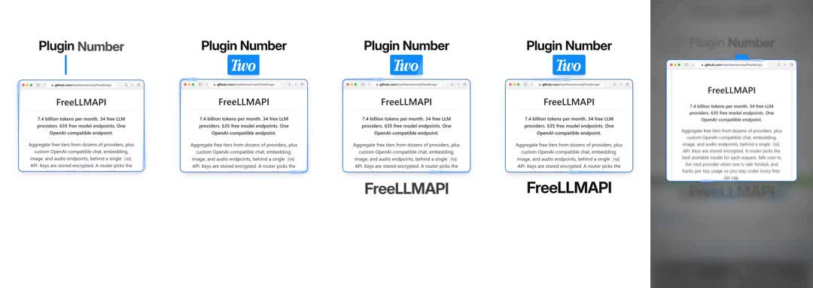

# v15_s06 · card_graphic · 11.8–13.5s (calidad 4)

- **Guion:** The second is Free LLM API,
- **Qué se ve:** [obs 11.75–13.25] Blanco: 'Plugin Number' + caja 'Two' + ventana FreeLLMAPI + nombre 'FreeLLMAPI'; en 13.25 todo se oscurece a gris.
- **Diseño:** Igual que s03.
- **Efectos:** [obs 13.25–13.5] fundido a gris oscuro (dim) antes del corte.
- **Animación:** [obs] mismo patrón de construcción que 'One'.
- **Por qué aquí:** [inf] Separador numerado.
