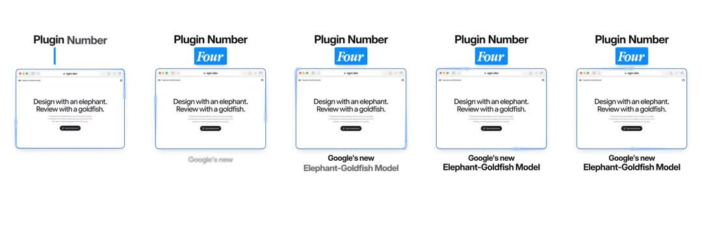

# v15_s13 · card_graphic · 30.7–33.2s (calidad 4)

- **Guion:** The fourth is Google's new Elephant Goldfish model,
- **Qué se ve:** [obs 30.75–33.0] Blanco: 'Plugin Number' + 'Four' + web 'Design with an elephant. Review with a goldfish.' + 'Google's new / Elephant-Goldfish Model'.
- **Diseño:** Nombre en dos líneas (L1 pequeña, L2 bold).
- **Efectos:** blanco
- **Animación:** [obs] mismo patrón; nombre write-on por línea (31.5, 32.0).
- **Por qué aquí:** [inf] Separador numerado.
