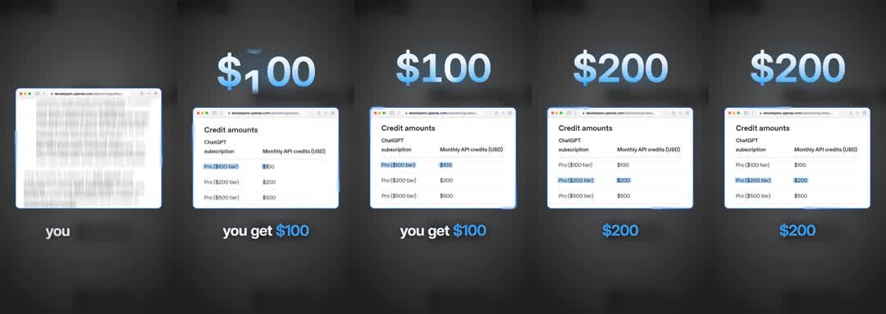

# v16_s05 · card_graphic · 7.2–9.1s (calidad 5)

- **Guion:** you get $100, $200, or
- **Qué se ve:** Cifra gigante '$100' sobre la ventana con tabla 'Credit amounts' (Pro $100/$200/$500 tier). La fila de la cifra se resalta en azul. Luego '$200'. Caption 'you get $100' / '$200'.
- **Diseño:** [observed 7.9] Cifra sans extra-bold ~9 % alto a y≈13–25 %, degradado blanco→azul #68B8F8 con glow. Ventana x 10–90 % × y 34.2–66.4 %. Caption y 72–76 %, cifra en azul #2898F8.
- **Efectos:** Glow azul de la cifra; viñeta del lienzo.
- **Animación:** [observed 7.13–7.5] transición interna: scroll vertical con motion-blur fuerte dentro de la ventana (whip-scroll ≈0.35 s) hasta la tabla. [observed 7.6–7.73] cifra entra con dígitos rodando (odómetro) + blur. [observed 8.33–8.40] '$100'→'$200' rodando el dígito; resaltado de fila salta a la siguiente.
- **Por qué aquí:** [inferred] Dato: el número dicho se hace enorme y se ancla a la fila real de la tabla.
