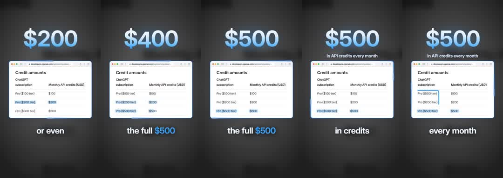

# v16_s06 · card_graphic · 9.1–11.4s (calidad 5)

- **Guion:** even the full $500 in credits every month,
- **Qué se ve:** La cifra cuenta $200→$300→$400→$500; aparece subtítulo pequeño 'in API credits every month' bajo la cifra; fila $500 resaltada.
- **Diseño:** Cifra igual que s05; subtítulo sans semibold blanca pequeña (~1.5 % alto) a y≈26 %.
- **Efectos:** Glow azul.
- **Animación:** [observed 9.6–9.8] odómetro 200→300→400→500 (1 paso cada ~2 fr). [observed 10.5] subtítulo aparece con fade.
- **Por qué aquí:** [inferred] Clímax del dato: el conteo hace sentir el crecimiento hasta el máximo.
