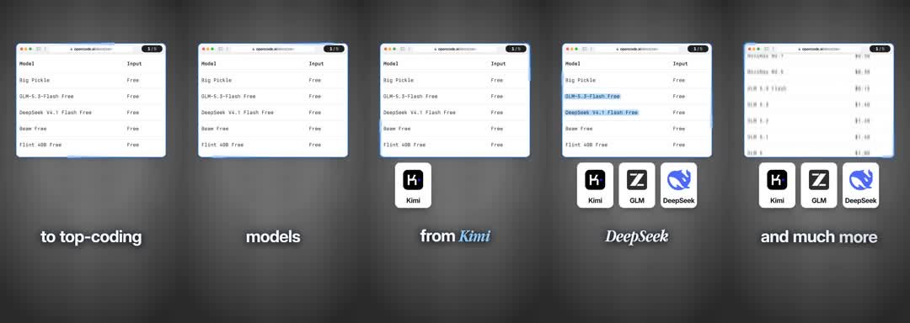

# v17_s07 · card_graphic · 9.3–12.2s (calidad 5)

- **Guion:** top coding models from Kimi, GLM, DeepSeq, and much more.
- **Qué se ve:** Tabla de modelos (Big Pickle, GLM-5.3 Flash, DeepSeek V4.1 Flash, Beam, Flint — 'Free'); bajo la ventana aparecen tarjetas-logo Kimi, GLM, DeepSeek una por palabra; filas resaltadas; luego scroll a lista con precios.
- **Diseño:** Tarjetas cuadradas blancas radio ~15 % (~10 % ancho) con logo y nombre, en fila a y≈52–58 %. 'Kimi', 'DeepSeek' serif itálica azul en caption.
- **Efectos:** —
- **Animación:** [observed 10.5, ~10.8, 11.0] cada logo pop (escala+fade ≈3 fr); [observed 11.5] scroll con blur.
- **Por qué aquí:** [inferred] Literal: cada nombre → su logo (lista visual).
