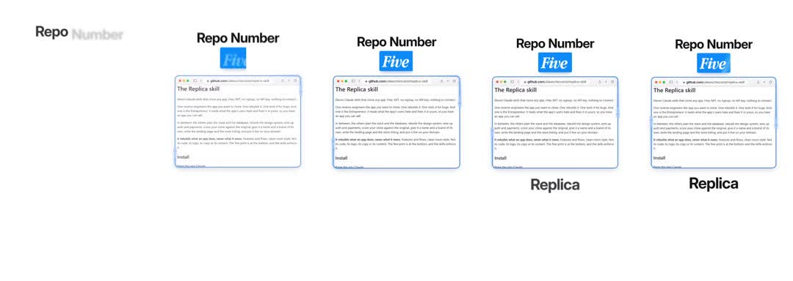

# v17_s22 · card_graphic · 38.4–39.2s (calidad 4)

- **Guion:** And finally, Replica.
- **Qué se ve:** Capítulo 5: 'Repo Number / Five' + ventana 'The Replica skill' + 'Replica'.
- **Diseño:** Tarjeta de capítulo sobre blanco: 'Repo Number' sans bold negra (y≈13 %), número en serif itálica bold blanca sobre caja #0A88F8 (y≈17–21 %), ventana con la home del repo (x 12–88 %, y 27–60 %, borde #3F85D4 ≈3 px), nombre del repo sans bold negra debajo (y≈64 %).
- **Efectos:** Blanco.
- **Animación:** [observed] 'Repo' aparece, 'Number' write-on gris→negro (≈3 fr), la caja azul crece desde una línea vertical (≈3 fr) y el número se escribe dentro; la ventana entra con fade desde gris (≈4 fr). Total ≈0.35 s.
- **Por qué aquí:** [inferred] Último separador.
