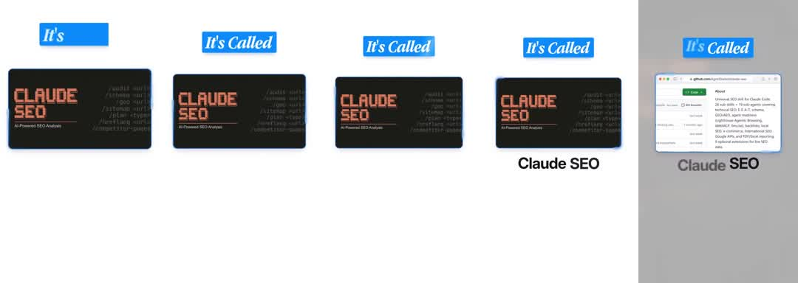

# v18_s04 · card_graphic · 7.1–8.3s (calidad 5)

- **Guion:** This is called Claude SEO,
- **Qué se ve:** Tarjeta blanca: caja azul 'It's Called' (serif itálica blanca) + imagen ASCII-art 'CLAUDE SEO' naranja sobre negro + 'Claude SEO' sans bold negra debajo.
- **Diseño:** [observed 7.6] caja azul x 27–73 %, y 12.3–19.5 %; ventana x 11–89 %, y 26.8–52.3 %; nombre y≈57 %.
- **Efectos:** Blanco plano.
- **Animación:** [observed 7.13–7.33] caja azul crece y 'It's Called' write-on; [observed 7.93] nombre gris→negro; [observed 8.27–8.53] la imagen se sustituye por la página GitHub y el blanco funde a negro (match-cut).
- **Por qué aquí:** [inferred] Tarjeta-nombre: presenta el producto como capítulo.
