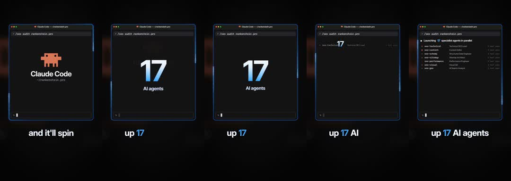

# v18_s11 · card_graphic · 22.3–23.6s (calidad 5)

- **Guion:** up 17 AI agents
- **Qué se ve:** El logo de la terminal se funde en un '17' gigante con 'AI agents' debajo, dentro de la ventana.
- **Diseño:** Cifra sans extra-bold blanca ~10 % alto centrada en la ventana; caption 'up 17 AI agents' con 17 azul.
- **Efectos:** Blur de transición.
- **Animación:** [observed 22.47–22.6] crossfade con blur logo→cifra (≈3 fr); la cifra sube a la parte superior en 23.0.
- **Por qué aquí:** [inferred] Dato.
