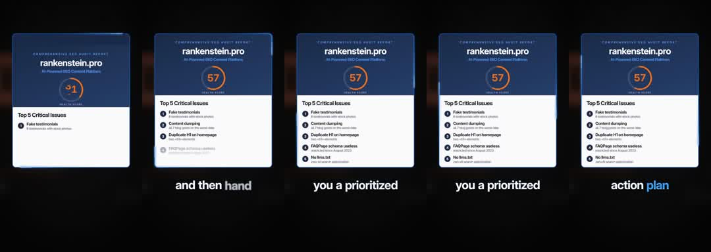

# v18_s13 · card_graphic · 25.6–27.7s (calidad 5)

- **Guion:** and then hand you a prioritized action plan
- **Qué se ve:** Tarjeta-informe 'COMPREHENSIVE SEO AUDIT REPORT · rankenstein.pro' cabecera azul marino, anillo naranja con puntuación 57 y 'Top 5 Critical Issues' con viñetas numeradas.
- **Diseño:** Cabecera #183858; anillo naranja #F87818; ventana x 10–90 %, y≈13–55 %; 'plan' azul.
- **Efectos:** —
- **Animación:** [observed 25.73–25.93] corte; anillo cuenta hasta 57 (odómetro); issues aparecen uno a uno (25.8–26.3).
- **Por qué aquí:** [inferred] Resultado tangible: la promesa del plan priorizado.
