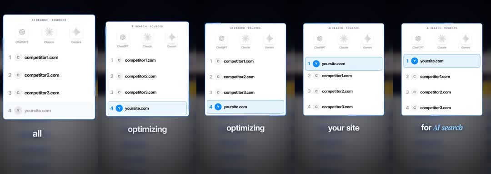

# v18_s17 · card_graphic · 35.4–37.2s (calidad 5)

- **Guion:** all while optimizing your site for AI search,
- **Qué se ve:** Tarjeta 'AI SEARCH · SOURCES' con logos grises ChatGPT/Claude/Gemini y ranking: yoursite.com sube de la posición 4 a la 1 con animación de reordenamiento.
- **Diseño:** Tarjeta blanca x 10–90 %, y 13–66 %; fila propia con fondo azul claro y avatar 'Y' azul; 'AI search' serif itálica azul.
- **Efectos:** Fondo oscuro desenfocado con bokeh.
- **Animación:** [observed 35.33] corte; [observed 36.33–36.73] reorder: la fila sube posición a posición (≈0.4 s, ease).
- **Por qué aquí:** [inferred] Visualiza 'optimizar' = subir al #1.
