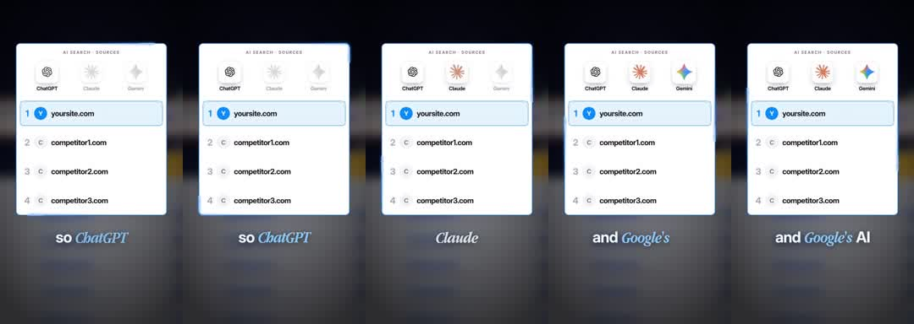

# v18_s18 · card_graphic · 37.5–39.5s (calidad 4)

- **Guion:** so chat GPT, Claude, and Google's AI
- **Qué se ve:** Los logos ChatGPT, Claude y Gemini pasan de gris a color uno por nombre.
- **Diseño:** 'ChatGPT', 'Claude', 'Google's' serif itálica azul.
- **Efectos:** —
- **Animación:** [observed ~37.9, ~38.6, ~39.3] logo a color por palabra.
- **Por qué aquí:** [inferred] Literal.
