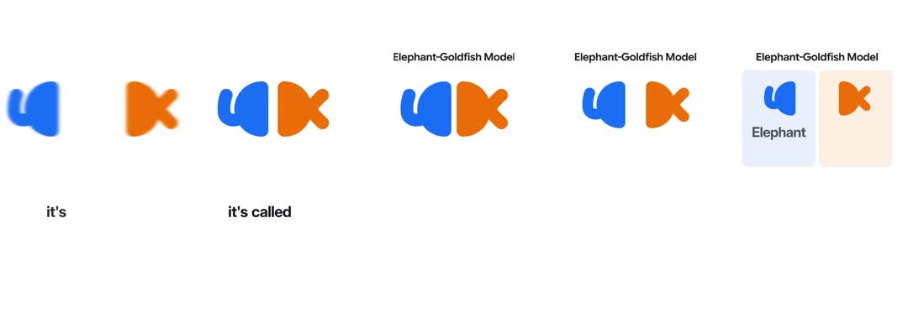

# v19_s06 · card_graphic · 8.8–10.4s (calidad 5)

- **Guion:** It's called the Elephant Goldfish Model,
- **Qué se ve:** Lienzo blanco: los dos logos (elefante azul, pez naranja) entran deslizándose y cruzándose desde los lados hasta quedar juntos al centro; encima aparece 'Elephant-Goldfish Model'.
- **Diseño:** Logos ~25 % ancho cada uno, centrados a y≈33 %; título sans semibold negra ~2.5 % alto a y≈17 %. Azul #0868F8, naranja #F87808.
- **Efectos:** Blanco plano.
- **Animación:** [observed 8.8–9.07] slide cruzado con motion-blur (≈8 fr) y asentamiento; [observed 9.5] título fade-in.
- **Por qué aquí:** [inferred] Tarjeta de nombre: la marca visual del método.
