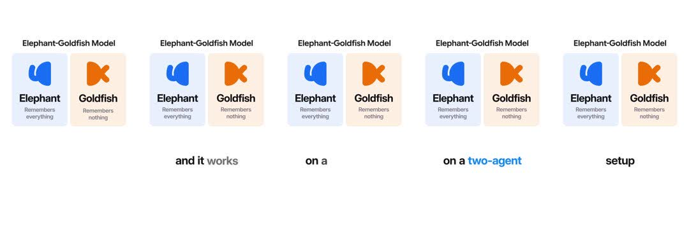

# v19_s07 · card_graphic · 10.5–12.2s (calidad 5)

- **Guion:** and it works in a two -agent setup.
- **Qué se ve:** Los logos se separan en dos tarjetas: 'Elephant · Remembers everything' (fondo azul pálido) y 'Goldfish · Remembers nothing' (fondo melocotón).
- **Diseño:** Tarjetas ~38 % ancho × 18 % alto, radio ~4 %, a y≈20–38 %; títulos sans bold, subtítulo gris pequeño. Caption 'on a two-agent' con 'two-agent' azul a y≈66 %.
- **Efectos:** —
- **Animación:** [observed 10.0–10.5] tarjetas crecen detrás de los logos y aparecen textos (fade).
- **Por qué aquí:** [inferred] Comparación A/B de los dos roles.
