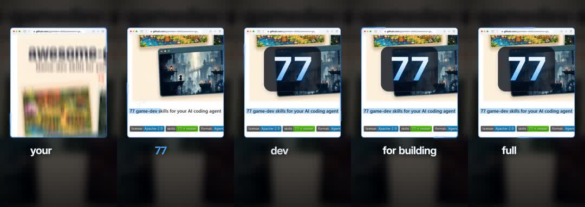

# v20_s04 · card_graphic · 6.1–9.2s (calidad 5)

- **Guion:** your coding agent 77 game dev skills for building full games
- **Qué se ve:** Whip-scroll al banner del repo (collage de juegos) y '77 game-dev skills for your AI coding agent' resaltado; píldora oscura '77' con odómetro sobre el banner.
- **Diseño:** Píldora gris oscuro semitransparente, cifra sans extra-bold blanca ~7 % alto, a la izquierda del banner (y≈20–28 %). Caption '77' azul.
- **Efectos:** Glass/blur detrás de la píldora.
- **Animación:** [observed 6.13–6.4] whip-scroll vertical con blur fuerte; [observed 6.87–7.2] odómetro 38→52→64→77; [observed 9.2–9.33] píldora se desvanece.
- **Por qué aquí:** [inferred] Dato principal.
