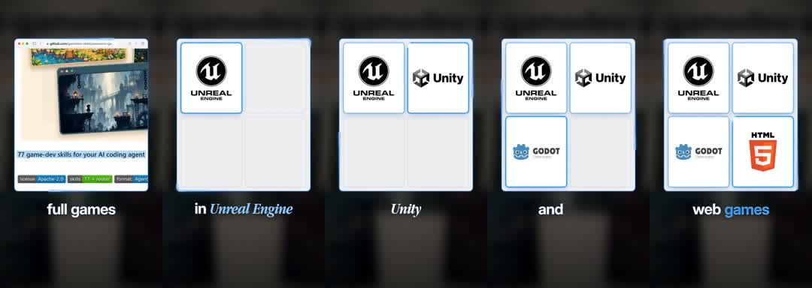

# v20_s05 · card_graphic · 9.2–12.1s (calidad 5)

- **Guion:** in Unreal Engine, Unity, Godot, and even web games.
- **Qué se ve:** La ventana se convierte en rejilla 2×2 de tarjetas blancas; cada logo aparece al nombrarlo: Unreal Engine, Unity, Godot, HTML5.
- **Diseño:** Rejilla 2×2 de tarjetas blancas ~40 % ancho × 24 % alto con contorno azul claro #8DBDEB ≈3 px (fila 1 y 14.8–39.3 %, fila 2 y≈40–66 %), logos centrados; marcas en serif itálica azul en el subtítulo (y≈72 %).
- **Efectos:** —
- **Animación:** [observed 9.53] rejilla vacía + Unreal; [observed 10.5] Unity; [observed ~11.0] Godot; [observed ~11.5] HTML5 (pop ≈2 fr cada uno).
- **Por qué aquí:** [inferred] Lista de motores = rejilla que se llena.
