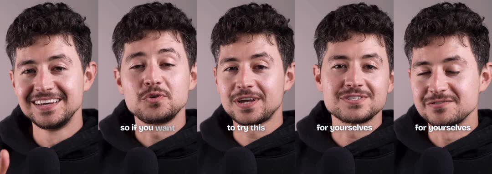

# v01_s14 · face_full · 28.9–30.3s (calidad 3)

- **Guion:** So if you want to try this for yourselves, just
- **Qué se ve:** [obs] Corte a Nick a pantalla completa, primer plano cerrado, fondo liso rosado-gris, micrófono oscuro asomando abajo. Caption 'so if you want'.
- **Diseño:** [obs] Caption sans bold blanca, y 73.3–76.1 % (centro ≈75 %), sobre el pecho/micrófono.
- **Efectos:** [obs] Fondo #B5A0A5 (rosado grisáceo) liso; sin cuadrícula.
- **Animación:** [obs] Corte seco en ~28.98 sin transición; sin movimiento de cámara apreciable.
- **Por qué aquí:** [inf] El CTA se dice a cámara: cara completa para máxima conexión antes de pedir el comentario.
