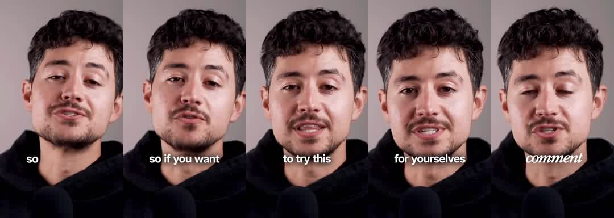

# v11_s16 · face_full · 37.2–38.8s (calidad 3)

- **Guion:** So if you want to try this for yourselves, just
- **Qué se ve:** [obs 37.0–38.5] Corte a él a pantalla completa, primer plano, sudadera negra, fondo gris liso, micrófono negro abajo.
- **Diseño:** Subtítulo sans bold blanca ~3.5 % alto en y≈72 % (pecho).
- **Efectos:** [obs] grade natural, fondo gris #A9A2A4 aprox.
- **Animación:** [obs 37.0] corte seco; sin zoom apreciable.
- **Por qué aquí:** [inf] El CTA se dice a cámara: conexión directa.
