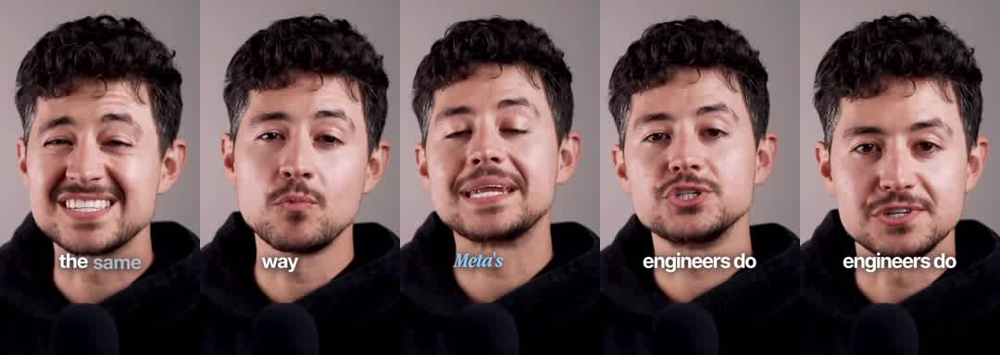

# v12_s03 · face_full · 6.7–8.6s (calidad 3)

- **Guion:** same way that Meta's own engineers do.
- **Qué se ve:** [obs 6.5–8.25] Corte a él en primer plano a pantalla completa, sonriendo, fondo gris, micrófono abajo.
- **Diseño:** Subtítulo sans bold blanca y≈72 %; 'Meta's' serif itálica azul claro.
- **Efectos:** [obs] grade natural; fondo gris liso.
- **Animación:** [obs 6.6] corte seco; sin zoom.
- **Por qué aquí:** [inf] Respiro de cara + afirmación de autoridad ('como los ingenieros de Meta').
