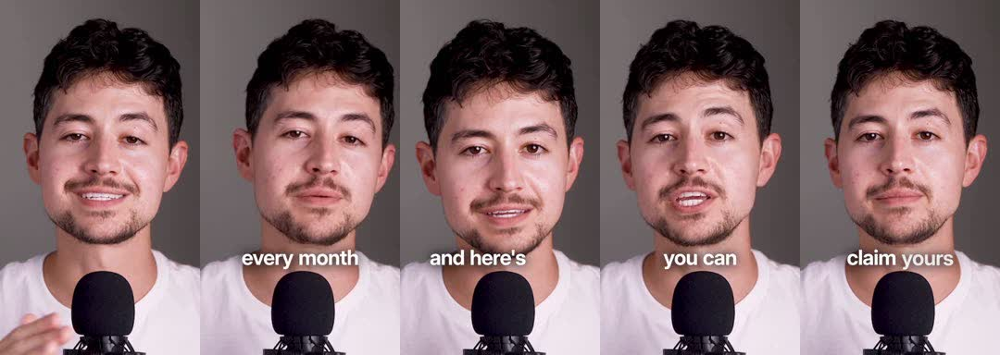

# v16_s03 · face_full · 3.3–5.3s (calidad 3)

- **Guion:** every month, and here's how you can claim yours.
- **Qué se ve:** Corte (3.43) a Nick a pantalla completa, plano medio-corto frontal, camiseta blanca, micrófono negro en primer término, fondo gris liso. Caption 'every month' → 'and here's how' → 'you can' → 'claim yours'.
- **Diseño:** Caption sans semibold blanca con sombra suave ~3.5 % alto a y≈72 % (sobre el micro, bajo la boca). Sin palabra en color.
- **Efectos:** Fondo gris neutro desenfocado (#706869), sin textura.
- **Animación:** [observed] Corte seco; palabras entran gris→blanco por palabra.
- **Por qué aquí:** [inferred] Cuando anuncia ('here's how') → cara: conexión personal y promesa del tutorial.
