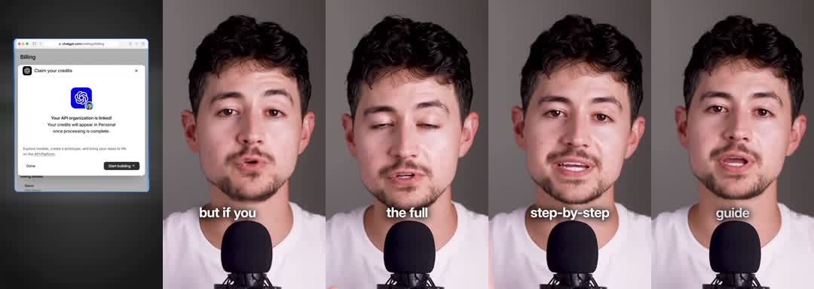

# v16_s18 · face_full · 27.9–29.6s (calidad 3)

- **Guion:** But if you want the full step -by -step guide,
- **Qué se ve:** Corte (28.0) a Nick a pantalla completa con micro. Caption acumulativa 'but if you want' / 'the full' / 'step-by-step' / 'guide'.
- **Diseño:** Caption sans semibold blanca y≈72 %.
- **Efectos:** Fondo gris de estudio.
- **Animación:** [observed] corte seco; palabras gris→blanco.
- **Por qué aquí:** [inferred] Pre-CTA: vuelve la cara para pedir algo.
