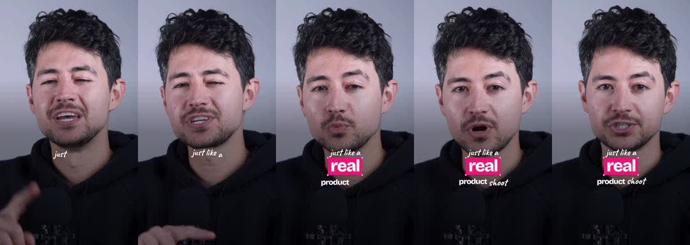

# v04_s08 · face_full_word · 14.1–15.2s (calidad 5)

- **Guion:** just like a real product shoot.
- **Qué se ve:** [obs] Nick a pantalla completa, fondo gris azulado; frase compuesta: 'just like a' itálica script pequeña, 'real' sans black blanca en caja magenta, 'product' sans bold blanca pequeña y 'shoot' script.
- **Diseño:** [obs] Bloque centrado y≈62–70 % sobre el pecho; 'real' ~4 % alto.
- **Efectos:** [obs] Fondo de cámara #B0B0C8 aprox.
- **Animación:** [obs] Corte en 14.03; palabras aparecen una a una ('just' 14.1, 'like' 14.2, 'real' 14.43 pop en caja, 'product' 14.7, 'shoot' 14.95).
- **Por qué aquí:** [inf] Remate emocional a cámara con tipografía mezclada para la comparación ('como una sesión real').
