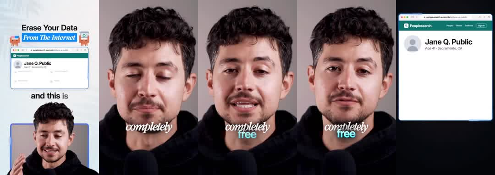

# v13_s02 · face_full_word · 3.5–4.4s (calidad 5)

- **Guion:** completely free.
- **Qué se ve:** [obs 3.75–4.25] Corte a él a pantalla completa; 'completely' en serif itálica blanca y debajo 'free' con degradado cian y glow (mismo tratamiento que el CTA).
- **Diseño:** [medido 4.2] 'free' y 74.5–78.5 %, degradado #45BBCC→#AFFDFF, glow; 'completely' serif itálica blanca encima (y≈71–74 %).
- **Efectos:** [obs] glow cian; fondo gris liso del A-roll.
- **Animación:** [obs 3.68] corte seco; 'completely' aparece, 'free' pop en 4.0 (≈0.1 s).
- **Por qué aquí:** [inf] Remate del hook: la palabra de valor ('free') recibe el tratamiento más llamativo, a cámara.
