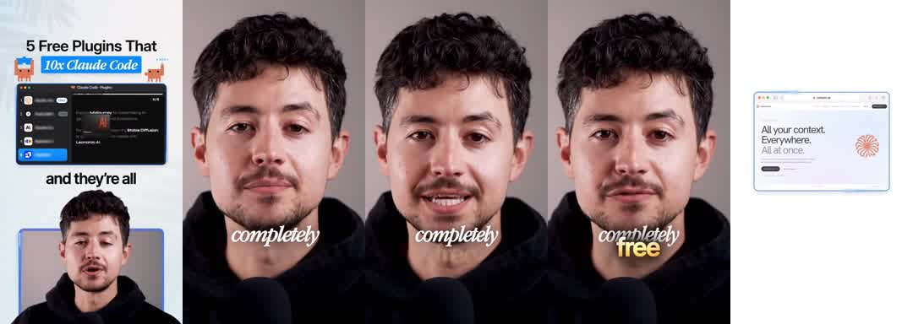

# v15_s02 · face_full_word · 3.9–4.7s (calidad 5)

- **Guion:** completely free.
- **Qué se ve:** [obs 4.0–4.5] Corte a cara completa; 'completely' serif itálica blanca + 'free' con degradado DORADO/ámbar y glow.
- **Diseño:** [derivado, medida contaminada por piel] 'free' y≈74–78 %, degradado ámbar→crema aprox. #B88A5A→#FDE1A2.
- **Efectos:** [obs] glow cálido.
- **Animación:** [obs 4.02] corte seco; 'free' aparece primero tenue/desenfocado (4.25) y se enfoca (4.5).
- **Por qué aquí:** [inf] Remate del hook con la palabra de valor, a cámara (mismo patrón que v13).
