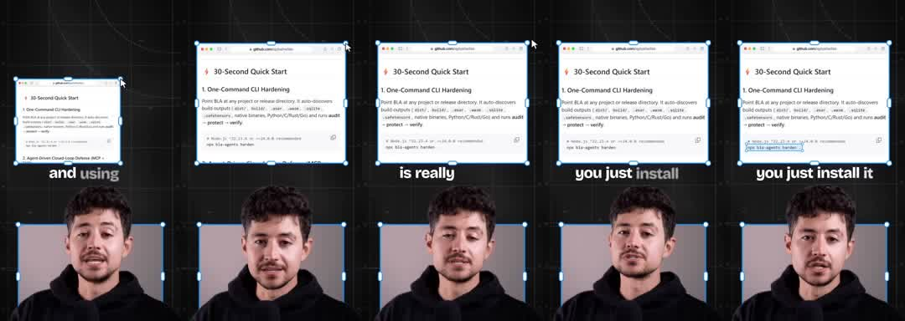

# v01_s05 · frame_split · 8.6–10.5s (calidad 4)

- **Guion:** And using it is really simple. You just install it
- **Qué se ve:** [obs] Vuelve el layout base: ventana de navegador blanca (github.com/qybaihe/bla) con '30-Second Quick Start / 1. One-Command CLI Hardening' arriba y Nick en recuadro abajo. Caption 'is really simple' con 'simple' azul.
- **Diseño:** [obs] Ventana 82.6 % ancho × 37.5 % alto, y 13.2–50.7 %, x 8.5–91.1 %. Caption y 51.9–56.3 %. Cara top y=69.8 %.
- **Efectos:** [obs] Ninguno sobre la captura; lienzo con cuadrícula.
- **Animación:** [obs] Corte seco en 8.50; la ventana entra pequeña (~70 %) anclada arriba-izquierda y crece hasta su tamaño en ~0.4 s (8.53→8.9) con un cursor en la esquina superior derecha, como si se redimensionara arrastrando el asa. El recuadro de cara ya está en su sitio.
- **Por qué aquí:** [inf] 'Es muy simple' → enseñar la página real de instalación con la cara: credibilidad + conexión.
