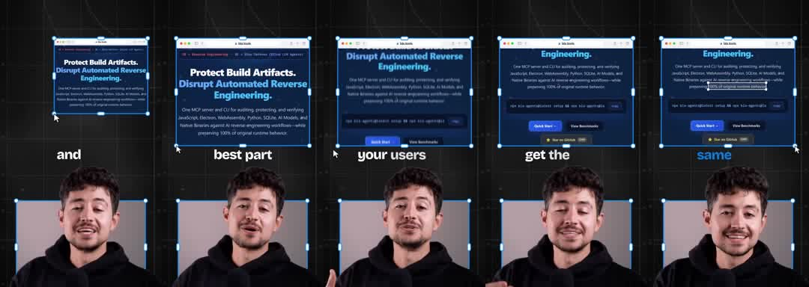

# v01_s10 · frame_split · 21.7–23.9s (calidad 4)

- **Guion:** And the best part is your users still get the exact same
- **Qué se ve:** [obs] Vuelve la cara abajo; ventana con la web bla.tools (fondo azul oscuro, 'Protect Build Artifacts. Disrupt Automated Reverse Engineering.'), hace scroll; 'same' en azul y un resaltado sobre '100% of original runtime behavior'.
- **Diseño:** [obs] Ventana final 82.6 % × 37.5 % (y 13.2–50.7 %). Caption y≈54 %.
- **Efectos:** [obs] Ninguno.
- **Animación:** [obs] Corte en 21.70; la ventana entra al ~70 % centrada arriba y crece a tamaño completo en ~0.35 s (21.73→22.1) con cursor en la esquina inferior izquierda (redimensionado); scroll hacia abajo 22.6–23.0; resaltado en 'same' ~23.7.
- **Por qué aquí:** [inf] Beneficio para el usuario → se devuelve la cara (tono personal, 'lo mejor').
