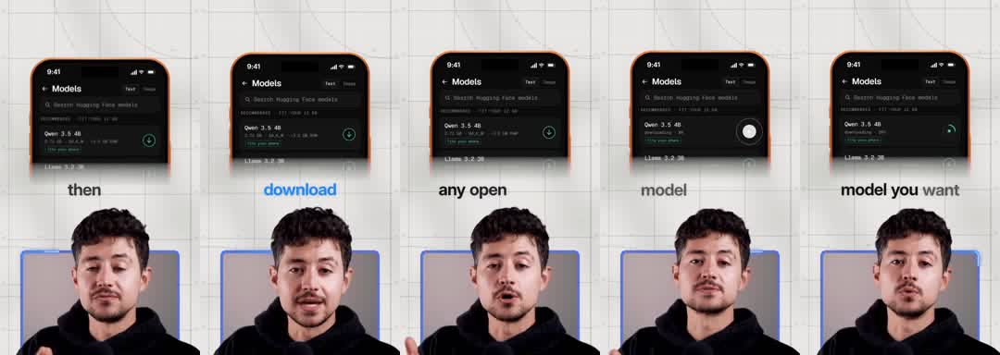

# v02_s08 · frame_split · 12.3–14.2s (calidad 4)

- **Guion:** Then you download any open source model you want
- **Qué se ve:** [obs] Vuelve el lienzo claro con cuadrícula: arriba la parte superior del iPhone (pantalla 'Models', Qwen 3.5 4B con botón de descarga) que se desvanece por abajo; Nick en recuadro azul. Un círculo blanco (toque) pulsa descargar.
- **Diseño:** [obs] Recorte del teléfono x ≈15–85 %, y ≈14–42 % sin borde azul, fundido a transparente en su parte inferior; caption y≈56–58 % oscura; 'download' azul. Cara top y=70.5 %.
- **Efectos:** [obs] Máscara de degradado inferior sobre el teléfono; sombra suave.
- **Animación:** [obs] Corte en 12.24; indicador de toque (círculo blanco) aparece 12.8–13.3 sobre el botón; spinner de descarga 13.5.
- **Por qué aquí:** [inf] Paso de uso → vuelve la cara (guía personal) con la UI arriba.
