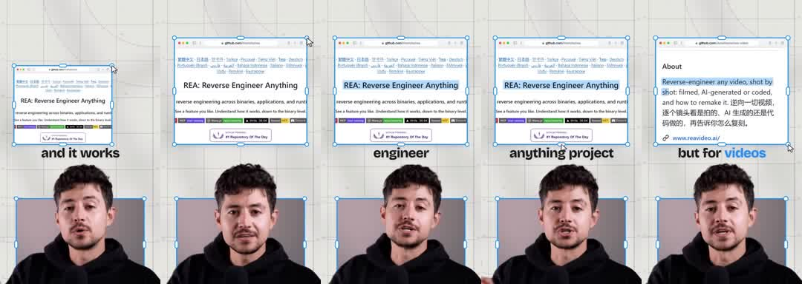

# v03_s04 · frame_split · 7.2–10.1s (calidad 3)

- **Guion:** and it works just like the Reverse Engineer Anything project, but for videos.
- **Qué se ve:** [obs] Vuelve lienzo claro + cara; ventana con el repo 'REA: Reverse Engineer Anything' (resaltado azul en el título); a 'but' la ventana se redibuja con la sección 'About' y se resalta 'Reverse-engineer any video, shot by shot'.
- **Diseño:** [obs] Ventana x 8.5–91.1 %, y 13.2–50.7 % (82.6 × 37.5 %); caption oscura y≈54 %; 'videos' azul.
- **Efectos:** [obs] Lienzo claro con cuadrícula.
- **Animación:** [obs] Corte en 7.04; ventana nace pequeña arriba-izquierda (~55 %) y crece con cursor en esquina inferior-derecha (7.04–7.44). En 9.53 la ventana se vuelve a dibujar pequeña con nuevo contenido y crece (9.53–9.87); resaltado de texto 9.87–10.0.
- **Por qué aquí:** [inf] Comparación con un proyecto conocido → se muestra el proyecto padre y luego la diferencia ('but for videos').
